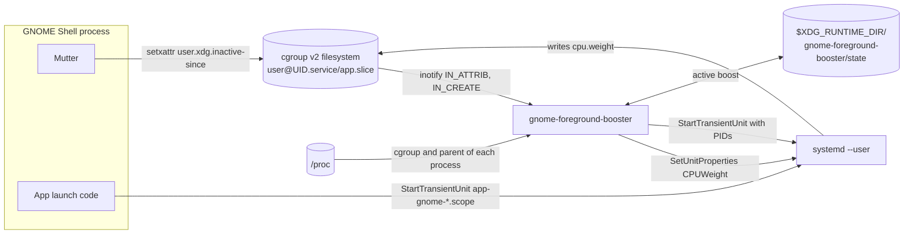
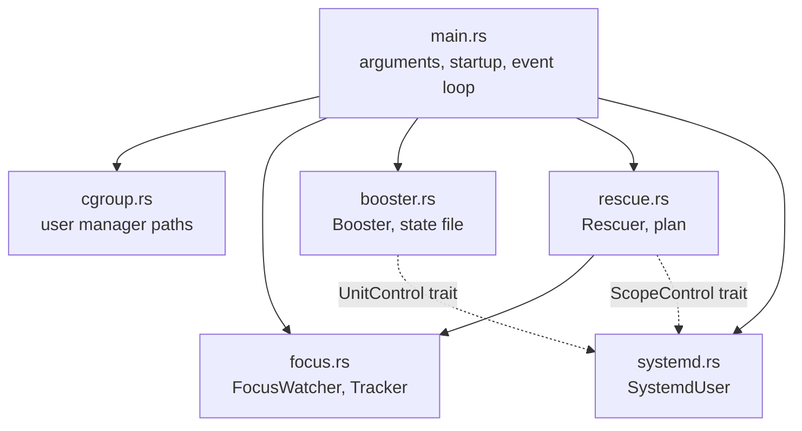
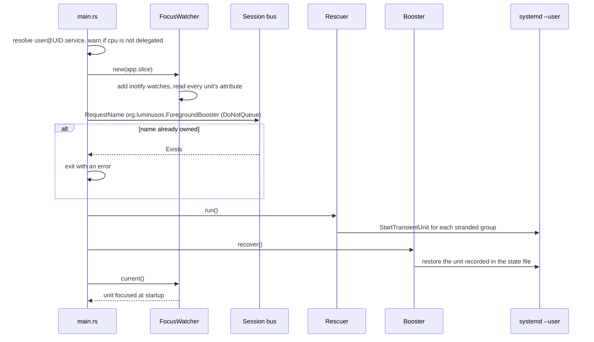
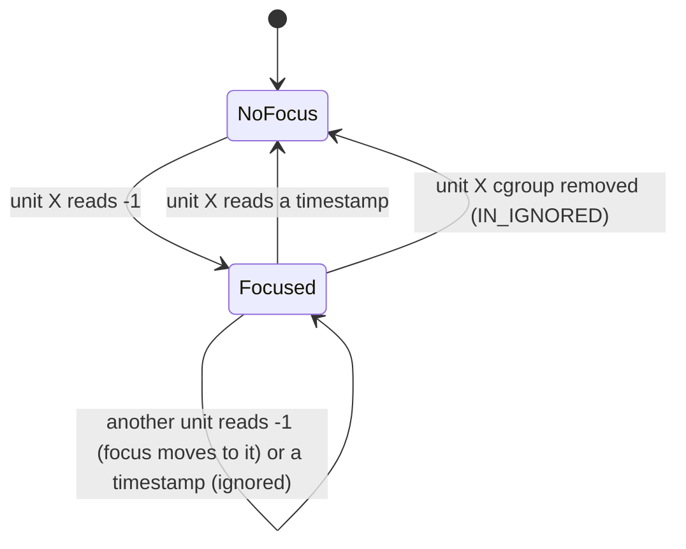
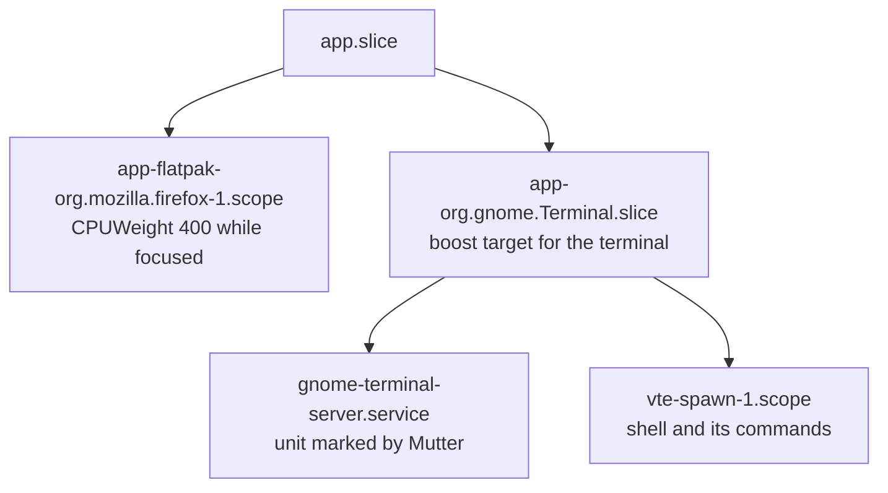
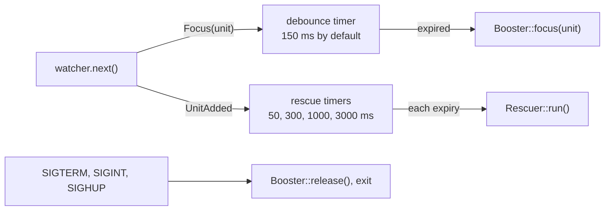
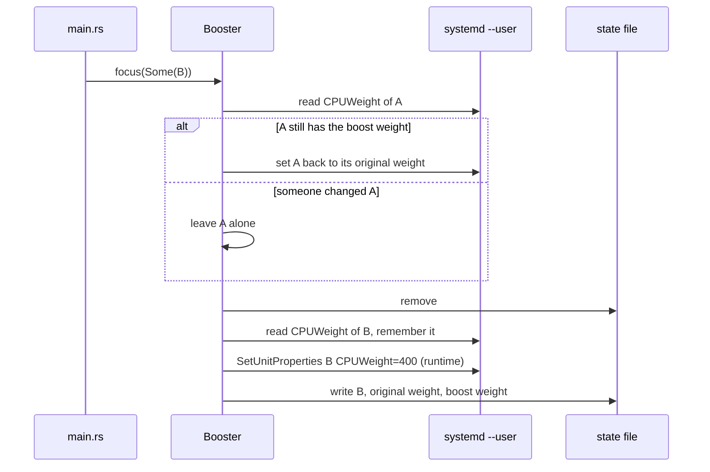
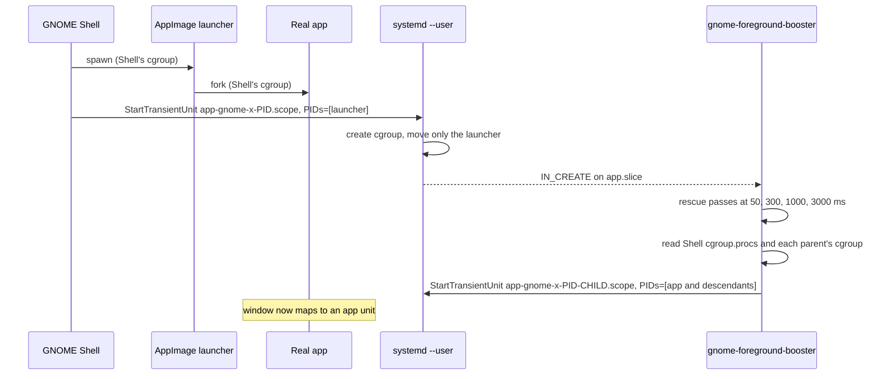
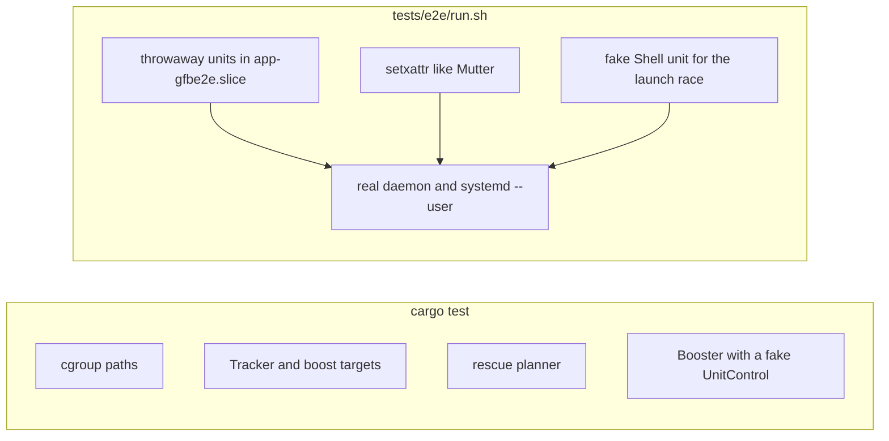

# Architecture

gnome-foreground-booster is a single-threaded user daemon. It reads which app has focus from cgroup extended attributes that Mutter maintains, changes that app's `CPUWeight` through the systemd user manager, and moves processes that GNOME Shell left in its own cgroup into a scope of their own. This document describes how those pieces fit together. For installation and usage, see the [README](README.md).

## System context

The daemon talks to no part of GNOME Shell directly. Its only inputs are the cgroup filesystem and `/proc`, and its only output is D-Bus calls to `systemd --user`.

Since GNOME 41, Mutter stores `-1` in `user.xdg.inactive-since` on the cgroup directory of the focused window's unit, and a monotonic timestamp on the unit that just lost focus. It only writes when focus moves between different units.

## Modules

| Module | Responsibility |
| --- | --- |
| `cgroup.rs` | Finds the current user's `user@UID.service` cgroup and checks that the `cpu` controller is delegated. |
| `focus.rs` | Watches `app.slice` and its sub-slices with inotify, reads the focus attribute and reports the boost target, plus a signal when a new app unit appears. |
| `booster.rs` | Applies and restores `CPUWeight`, keeps the state file, and recovers a boost left by a previous run. Talks to systemd through the `UnitControl` trait. |
| `rescue.rs` | Finds processes stranded in the Shell's cgroup and decides which scope each group belongs next to. Talks to systemd through the `ScopeControl` trait. |
| `systemd.rs` | Implements both traits over the systemd user manager's D-Bus API with zbus. |
| `main.rs` | Wires everything together and runs the event loop. |

The two traits keep the decision logic free of D-Bus, so `Booster` and the rescue planner are unit tested against fakes.

## Startup

The bus name only guarantees a single instance. The daemon exports no D-Bus interface of its own.

## Focus tracking

`FocusWatcher` keeps an inotify watch on every slice directory under `app.slice` for `IN_CREATE`, and one on every unit directory for `IN_ATTRIB`. On each attribute change it re-reads `user.xdg.inactive-since` and feeds the result to `Tracker`, which remembers at most one focused unit.

At startup, or after an inotify queue overflow, the watcher rescans the whole tree. If more than one unit carries `-1`, it trusts none of them and waits for the next change.

The boost target is the direct child of `app.slice` on the path to the focused unit. cgroup v2 only compares `cpu.weight` between siblings, so this is the level where one app competes with another:

## Event loop

`main.rs` runs one `tokio::select!` loop on a current-thread runtime. Besides the signal handlers, it waits on three things:

A focus change only replaces the pending target and restarts the debounce timer, so quick Alt+Tab sequences cost one boost at the end. Every new app unit schedules four rescue passes, because GNOME Shell moves the launcher into its scope only after the scope's cgroup exists, and stranded children may still fork.

## Boosting and restoring

All weight changes are runtime-only, so systemd drops them when the unit goes away. The state file covers the case where the daemon dies while a long-lived unit is boosted: on the next start, `recover()` restores that unit, again only if it still has the boost weight. A unit that disappears while boosted makes systemd answer `NoSuchUnit`, which the booster logs at debug level and otherwise ignores.

## Rescuing stranded processes

GNOME Shell spawns an app and only then asks systemd, asynchronously, to move its PID into a new `app-gnome-*.scope`. A launcher that forks during that gap leaves its children in `org.gnome.Shell@*.service`. AppImages do this: the runtime mounts the image and starts the real program right away. Mutter then attributes the app's windows to the Shell's unit, which the daemon must never boost.

`rescue::plan` selects a process from the Shell's cgroup when its parent lives in an app unit under `app.slice`, then adds every descendant that is still in the Shell's cgroup. The Shell's own children, such as Xwayland and glycin loaders, have the Shell as parent and are never selected. The new scope goes into the same slice as the launcher's unit, so it competes with other apps at the same level.

Mutter caches a window's unit the first time it needs it. A window mapped before the rescue keeps pointing at the Shell's unit until it is closed, which is why the daemon reacts to `IN_CREATE` instead of polling.

## Trust and failure handling

- Only `user@UID.service/app.slice` of the current user is watched, and only units below it are boosted.
- Any process of the same user can set the focus attribute and steer the boost between that user's own units. It could already change those weights through systemd, so this adds no privilege.
- Errors on individual units are logged and skipped. Apart from the signals, the loop only stops when focus watching itself fails, and it restores the active boost before exiting either way.
- The shipped unit runs with `NoNewPrivileges`, `ProtectSystem=strict`, `ProtectHome=read-only`, `PrivateTmp` and `RestrictAddressFamilies=AF_UNIX`. The daemon needs read access to `/sys/fs/cgroup` and `/proc`, a Unix socket to the session bus, and write access to its runtime directory.

## Testing

Unit tests cover the pure logic. The end-to-end script exercises the real inotify, D-Bus and systemd paths on isolated units, with the daemon pointed at a private slice through hidden `--app-slice` and `--shell-cgroup` flags and its state kept in a temporary directory, so it never touches running applications.
